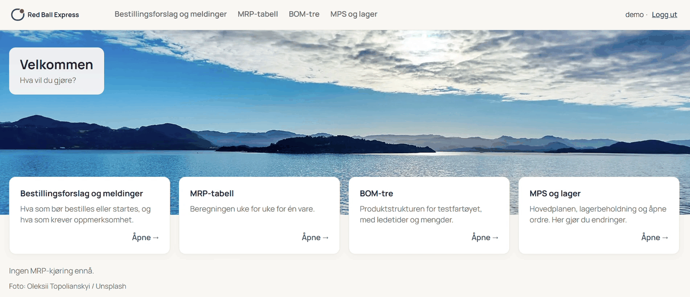

# G31 — Red Ball Express

Red Ball Express er en MRP-app (materialbehovsplanlegging) for skipsbygging. Målet er at den skal bryte ned stykklista (BOM) for et testfartøy på flere nivåer, regne ut nettobehov uke for uke ut fra hovedplanen (MPS), lager og åpne ordre, og foreslå bestillinger med riktig ledetid. Beregningen skal testes mot en håndregnet fasit.

Gruppeprosjekt i **IBE160 Programmering med KI** ved Høgskolen i Molde, høsten 2026 (15 studiepoeng). Repoet inneholder appen og dokumentasjon av utvikling, testing og kvalitetssikring med KI.



Video: [innlogging, startside og meny](docs/media/2026-11-26-innlogging-og-meny.mp4).

## Status

Dette virker nå: innlogging og utlogging, startsiden, menylinjen, testfartøyet i databasen, fasitparseren og testene. Sidene i menyen er foreløpig plassholdere. MRP-beregningen og skjermbildene for forslag, MRP-tabell, BOM-tre og MPS og lager kommer i senere epics (epic 2–5, se [sprintstatus](_bmad-output/implementation-artifacts/sprint-status.yaml)).

## Forutsetninger

- [Git](https://git-scm.com/downloads)
- [uv](https://docs.astral.sh/uv/getting-started/installation/) (henter selv Python 3.14 første gang)
- [Node.js 26 LTS](https://nodejs.org/en/download) (med npm)

Det trengs ingen kontoer, nøkler, Docker eller eksterne tjenester. Stien til repoet kan godt ha mellomrom.

## Oppstart

Klon repoet og gå inn i mappa. På Windows bør mappa du kloner i, ha en kort sti (se [Feilsøking](#feilsøking)).

```sh
git clone https://github.com/IBE160-2026/G31-navelsaker.git
cd G31-navelsaker
```

**Terminal 1 — backend** (port 8000):

```sh
cd backend
uv run python -m fastapi dev src/rbe/main.py
```

Første gang laster uv ned Python og pakkene, så det kan ta et minutt. Første start oppretter databasen `backend/data/rbe.db` og legger inn testfartøyet og demobrukeren. Advarselen om tilfeldig sesjonsnøkkel i loggen er forventet. La terminalen stå åpen.

**Terminal 2 — frontend** (port 5173), fra repoets rotmappe:

```sh
cd frontend
npm install
npm run dev
```

Åpne <http://localhost:5173> i nettleseren.

## Innlogging

| Brukernavn | Passord |
| --- | --- |
| `demo` | `demo` |

Dette er det kjente demopassordet og ingen hemmelighet. Brukernavn og passord kan endres med miljøvariablene `RBE_DEMO_USERNAME` og `RBE_DEMO_PASSWORD`. [backend/.env.example](backend/.env.example) lister alle variablene, og alle er valgfrie. Kopier den til `backend/.env` for å sette variablene. Sett `RBE_SESSION_SECRET` hvis du ikke vil bli logget ut hver gang backend starter på nytt, også når `fastapi dev` laster koden på nytt. Endrer du `RBE_DEMO_USERNAME`, lages en ny bruker, og den gamle står igjen til databasen tilbakestilles.

## Tester og kvalitetssjekk

Backend, i `backend/`:

```sh
uv run python -m pytest
uv run python -m ruff check
uv run python -m ruff format --check
```

På en maskin uten sperren som er beskrevet under [Feilsøking](#feilsøking), gir `uv run pytest` det samme.

Frontend, i `frontend/` (etter `npm install`):

```sh
npm run test
npx biome check
npm run build
```

Testene for fasitparseren og seed leser den håndregnede fasiten i [testdata/testfartoy-v1/](testdata/testfartoy-v1/README.md) direkte. Beregningstestene mot fasiten kommer i epic 2.

## Feilsøking

- **«Fikk ikke kontakt med serveren. Prøv igjen.»** ved innlogging betyr at frontend ikke når backend på port 8000. Se i terminal 1:
  - Står det ingen server der, er backend ikke startet. Start den og prøv igjen.
  - Har backend stoppet med en feilmelding, for eksempel «Fant ikke fasitfila» eller «os error 5», må feilen rettes først (se punktene under).
  - Kjører backend fra en annen mappe, for eksempel en eldre klone, svarer den i stedet for denne. Stopp den og start backend fra denne mappa.
- **Port 5173 er opptatt:** Vite velger da en annen port og skriver adressen i terminalen. Bruk den adressen. Backend må likevel kjøre på port 8000, fordi frontend sender `/api` dit.
- **Port 8000 er opptatt:** stopp prosessen som bruker porten, fordi frontend alltid sender `/api` til port 8000.
- **Tilbakestill databasen:** stopp backend, slett `backend/data/rbe.db` (eller fila `RBE_DATABASE_URL` peker på) og start backend igjen. Testfartøyet og demobrukeren legges da inn på nytt.
- **«Filename too long» fra git, eller `ModuleNotFoundError` i testene, på Windows:** stien til repoet er for lang for grensen på 260 tegn i Windows. Klon på nytt i en kort mappe utenfor OneDrive, for eksempel `C:\dev`.
- **«os error 5» (tilgang nektet) på Windows:** noen maskiner nekter å kjøre de kjørbare filene uv lager (`Failed to spawn … os error 5`). Kommandoene over bruker `python -m …`, så de virker selv om `pytest.exe` og `fastapi.exe` er sperret. Gjelder sperren også selve Python i `backend/.venv`, lag `.venv` med Pythons egen `venv` før `uv sync`. I PowerShell, i `backend/`:

  ```powershell
  Remove-Item -Recurse -Force .venv -ErrorAction SilentlyContinue
  & (uv python find --no-project 3.14) -m venv .venv
  uv sync
  ```

  Kjør deretter kommandoene over som vanlig.

## Dokumentasjon

- [Product brief](_bmad-output/planning-artifacts/briefs/brief-Red%20Ball%20Express-2026-09-16/brief.md)
- [PRD](_bmad-output/planning-artifacts/prds/prd-Red%20Ball%20Express-2026-11-24/prd.md) (krav FR-n, NFR-n og SM-n)
- [Arkitektur](_bmad-output/planning-artifacts/architecture/architecture-Red%20Ball%20Express-2026-11-24/ARCHITECTURE-SPINE.md)
- UX: [DESIGN.md](_bmad-output/planning-artifacts/ux-designs/ux-Red%20Ball%20Express-2026-11-24/DESIGN.md) og [EXPERIENCE.md](_bmad-output/planning-artifacts/ux-designs/ux-Red%20Ball%20Express-2026-11-24/EXPERIENCE.md)
- [Epics og stories](_bmad-output/planning-artifacts/epics.md) og [sprintstatus](_bmad-output/implementation-artifacts/sprint-status.yaml)
- [Testfartøy med håndregnet MRP-fasit](testdata/testfartoy-v1/README.md)
- [AI-logg](docs/ai-log.md) over KI-prompter og endringer

## Medlemmer

- Thobias Navelsaker

## Bildekreditering

Havbildet på startsiden er tatt av [Oleksii Topolianskyi](https://unsplash.com/photos/body-of-water-during-daytime-px368LdsbpQ) og brukes under [Unsplash-lisensen](https://unsplash.com/license).
