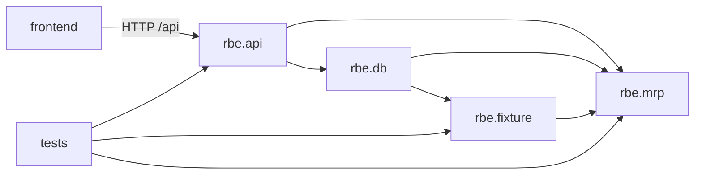
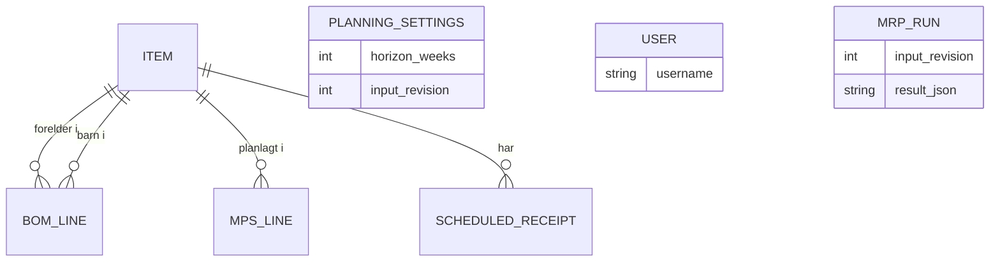
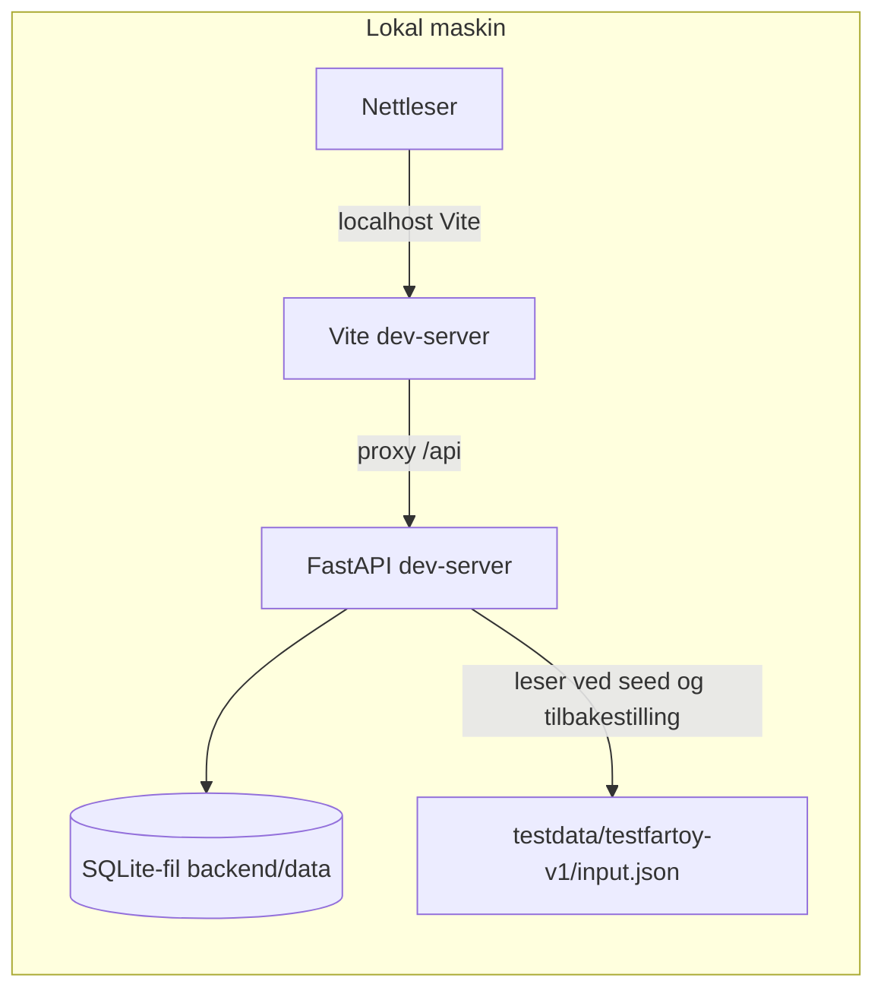

# Arkitektur — Red Ball Express v1

Beslutningene her binder alle stories i v1. Begrunnelser og forkastede alternativer står i [.memlog.md](.memlog.md). Begrepene følger ordlisten i [PRD-en](../../prds/prd-Red%20Ball%20Express-2026-11-24/prd.md) §3, og regnereglene R1–R11 står i [fasiten](../../../../testdata/testfartoy-v1/README.md).

## Designparadigme

**Funksjonell kjerne, imperativt skall.** MRP-beregningen og sammenligningen av kjøringer er rene funksjoner i `rbe.mrp`. Alt som har tilstand eller gjør I/O (database, HTTP, innlogging, filer), ligger i skallet rundt og kaller kjernen.

| Lag | Pakke / mappe | Ansvar |
| --- | --- | --- |
| Kjerne | `backend/src/rbe/mrp/` | LLC, bruttobehov, netting, partiregler, ledetidsoffset, R11, exception-meldinger, sammenligning av kjøringer |
| Fasitparser | `backend/src/rbe/fixture.py` | Leser `input.json` (med scenario-overstyring) til kjernens inndatatyper |
| Lagring | `backend/src/rbe/db/` | Tabeller, sesjon, seed, tilbakestilling, lese og skrive inndata og kjøringer |
| Web | `backend/src/rbe/api/` | FastAPI-rutere, Pydantic-skjemaer, validering, innlogging |
| Klient | `frontend/src/` | Skjermbilder. Viser data og sender endringer. Regner aldri MRP |

## Invarianter og regler



Pilene viser lovlig importretning. Ingen pil går inn i `rbe.api` fra backend, og ingen pil går ut av `rbe.mrp`.

### AD-1 — MRP-kjernen er ren [ADOPTED]

- **Binds:** NFR-3, FR-9 til FR-14, FR-17
- **Prevents:** at beregningslogikk havner i ruter eller ORM-modeller og ikke kan testes uten database og web
- **Rule:** `rbe.mrp` importerer bare standardbiblioteket og egne moduler. Den importerer aldri `rbe.db`, `rbe.api`, `rbe.fixture`, `fastapi`, `sqlalchemy`, `pydantic` eller `pydantic_settings`, og gjør ingen fil-, nett- eller klokkekall. En pytest-test (`tests/mrp/test_core_is_pure.py`) leser importene i `src/rbe/mrp/` med `ast` og feiler ved brudd. Inndata og resultat er frosne dataklasser.

### AD-2 — Én resultatform, lik fasiten [ADOPTED]

- **Binds:** FR-9 til FR-17, NFR-3
- **Prevents:** oversettelseslag og sprik mellom fasit, kjerne, lagret kjøring, API-svar og visning
- **Rule:** Kjernen returnerer et resultat med samme struktur og feltnavn som ett scenario i `expected.json`: per vare `low_level_code`, ukesarrayene `gross_requirements`, `scheduled_receipts`, `projected_on_hand`, `net_requirements`, `planned_order_receipts` og `planned_order_releases` (lengde = horisont, indeks 0 = uke 1), `planned_orders` (`receipt_week`, `release_week`, `quantity`), og en `exceptions`-liste med fasitens `type`-koder og tallfelt. Lagret kjøring og API-svar bruker den samme strukturen uten å endre navn. Hver vare får i tillegg `name`, `unit` og `on_hand` (startlager) ved siden av fasitfeltene, slik at visningen ikke trenger et eget oppslag. Fasitfeltene endres aldri. Kjernen returnerer meldinger som `type` + tallfelt, ikke som tekst.

### AD-3 — Deterministisk rekkefølge [ADOPTED]

- **Binds:** FR-9, FR-17
- **Prevents:** at to kjøringer på samme inndata gir ulik JSON, og at endringsmarkering slår ut på rekkefølge alene
- **Rule:** Varer sorteres på (`low_level_code`, `id`). `planned_orders` sorteres på `receipt_week`. `exceptions` sorteres på (`type`, `item`, `receipt_week` der feltet finnes). Ingen tidsstempel, tilfeldighet eller hash-rekkefølge i kjernens resultat.

### AD-4 — Fasiten er eneste kilde til testdata [ADOPTED]

- **Binds:** FR-2, FR-3, NFR-3, NFR-7
- **Prevents:** at seed-data og testdata blir to kopier som spriker fra `testdata/testfartoy-v1/`
- **Rule:** Ingen kopi av `input.json` eller av innholdet i kode, SQL eller andre filer. `rbe.fixture` er den eneste parseren av fasitformatet. Den brukes både av seed (alltid scenario A) og av tester (scenario A–E via `override`). Appen finner fila via `RBE_FIXTURE_PATH`, med repoets `testdata/testfartoy-v1/input.json` som standard. Tester finner fasiten via en sti fra `tests/conftest.py`.

### AD-5 — Databasen er avledet tilstand [ADOPTED]

- **Binds:** FR-2, FR-3, NFR-1, NFR-5
- **Prevents:** schemaforvaltning, migreringsfeil hos sensor og halvveis tilbakestilte data
- **Rule:** SQLite-fil i `backend/data/` (gitignorert). Tabellene opprettes med `create_all` ved oppstart, uten Alembic. Endres schemaet under utvikling, slettes fila. Ved oppstart: er varetabellen tom, seedes scenario A, og mangler demobrukeren, opprettes den. De to sjekkes hver for seg. «Tilbakestill til testdata» kjører i én transaksjon: slett alle inndata og alle MRP-kjøringer, last scenario A på nytt via `rbe.fixture`, og behold demobrukeren.

### AD-6 — Kjøringer er uforanderlige øyeblikksbilder, og endringer beregnes i kjernen [ADOPTED]

- **Binds:** FR-9, FR-15, FR-16, FR-17
- **Prevents:** to måter å avgjøre «det samme forslaget» på, og endringsmarkering som avhenger av lagringsformat
- **Rule:** «Kjør MRP» leser alle inndata i én transaksjon, kaller kjernen og lagrer resultatet (AD-2) som én rad `mrp_run(id, created_at, input_revision, result_json)`. Raden endres aldri. Alle kjøringer beholdes til tilbakestilling. Endringene mellom siste og nest siste kjøring beregnes ved lesing av en ren funksjon i `rbe.mrp`, med identitetsnøklene fra PRD-en:
  - bestillingsforslag: (`item`, `quantity`, `receipt_week`, `release_week`)
  - exception-melding: pares på (`type`, `item`). Flere meldinger av samme type for samme vare pares i rekkefølge etter `receipt_week`. Et par med like tallfelt er uendret. For E2 er et par med høyere `weeks_past_due` `worsened`, med lavere `improved`, og ellers `changed`. Meldinger uten par er `added` eller `resolved` (PRD FR-17, endret etter UX 2026-11-24)
  - celle: (`item`, felt, uke), der «Før u1»-kolonnen (startlager og forfalte frigivelser) også regnes som celler

  Uke 0 i en cellenøkkel betyr «Før u1»: `projected_on_hand` uke 0 er startlageret, og `planned_order_releases` uke 0 er summen av forfalte frigivelser. Funksjonen returnerer `{planned_orders: {added, removed}, exceptions: {added, resolved, paired: [{before, after, direction}]}, cells: [{item, field, week}]}`, der `direction` er `worsened`, `improved` eller `changed`, og API-et sender dette uendret ved siden av siste kjørings resultat. Uten nest siste kjøring er alle listene tomme. Funksjonen testes automatisk for A→B, A→C og A→E mot akseptansekriteriene i FR-17.

  Ikke-kjørte endringer (EXPERIENCE.md, linjen «Du har N endringer …») telles med `input_revision` i planinnstillingene. Telleren økes i samme transaksjon som hver lagret endring av inndata, men ikke ved avviste endringer. Hver `mrp_run` lagrer revisjonen den ble kjørt på. N er differansen mot siste kjøring, eller telleren selv når det ikke finnes noen kjøring. Tilbakestilling setter telleren til 0 (lagt til etter epics og stories 2026-11-24)

### AD-7 — Alle skrivinger går via backend, validert mot lagrede data [ADOPTED]

- **Binds:** FR-5, FR-6, FR-7, FR-8, FR-18, NFR-5, SM-C2
- **Prevents:** at frontend og backend validerer ulikt, at horisonten blir hardkodet, og at en ugyldig endring lagres halvveis
- **Rule:** Frontend sender endringer til `/api` og beregner aldri MRP eller lavnivåkoder selv. BOM-treet får LLC fra backend, som henter den fra `rbe.mrp`. Hver endring valideres i backend og lagres i én transaksjon, eller avvises uten at noe lagres. Grensene i FR-8 håndheves i backend. Uke valideres mot den lagrede horisonten, ikke mot konstanten 16. MPS-linjer kan bare gjelde nivå 0-varen, og byggenummer må være et heltall ≥ 1 og unikt i hovedplanen. Feil returneres i FastAPIs 422-format (`detail[].loc`, `detail[].msg`) med norske meldinger, og frontend viser dem ved feltet som `loc` peker på. Frontend kan validere tidlig for brukervennlighet, men backend er fasit.

### AD-8 — Innlogging med sesjonscookie, påkrevd som standard [ADOPTED]

- **Binds:** FR-1, NFR-2
- **Prevents:** ruter som glemmer innloggingssjekken, og token-håndtering i frontend
- **Rule:** Starlette `SessionMiddleware` gir en signert cookie (httpOnly, SameSite=Lax). Passord hashes med `pwdlib` (argon2). Alle rutere under `/api` får avhengigheten `require_user`. De eneste unntakene er `POST /api/auth/login` og `GET /api/health`. En test går gjennom `app.routes` og sjekker at alle andre ruter gir 401 uten innlogging. Feil brukernavn og feil passord gir samme feilmelding.

### AD-9 — Konfigurasjon fra miljøvariabler med trygge standardverdier [ADOPTED]

- **Binds:** NFR-1, NFR-2, SM-3
- **Prevents:** hemmeligheter i repoet, og at appen ikke starter uten manuell oppsett
- **Rule:** All konfigurasjon leses med `pydantic-settings`, med prefikset `RBE_`: `RBE_DATABASE_URL`, `RBE_FIXTURE_PATH`, `RBE_SESSION_SECRET`, `RBE_DEMO_USERNAME` og `RBE_DEMO_PASSWORD`. `.env` er valgfri og gitignorert. `backend/.env.example` lister alle variablene uten ekte verdier. Mangler `RBE_SESSION_SECRET`, lager appen en tilfeldig nøkkel ved oppstart og logger en advarsel. Demopassordet er et kjent demopassord og står i README. Ingen annen kode leser `os.environ`.

### AD-10 — Testene kjøres med én kommando og viser til krav og scenario [ADOPTED]

- **Binds:** NFR-3, NFR-7, SM-1, SM-4, SM-C2
- **Prevents:** tester som ikke kan spores til krav, og en kjerne som bare består fordi den er tilpasset testfartøyet
- **Rule:** `uv run pytest` i `backend/` kjører alle backendtester.
  - Fasittestene er parametrisert over scenario × vare × felt og sammenligner hele ukesarrayer. Testnavnet eller test-id-en oppgir scenario og FR-nummer. `exceptions` sammenlignes som usortert mengde.
  - Skalatesten bruker en generator med fast seed (~500 varer, 10 nivåer, en felles komponent på flere nivåer). Den sjekker at beregningen fullfører, at LLC stemmer med en uavhengig beregning av lengste vei, og at massebalansen fra NFR-3 går opp for alle varer.
  - Integrasjonstester mot `TestClient` og en midlertidig SQLite-fil dekker FR-1, FR-2, FR-3, FR-8 og AD-8.

### AD-11 — Lokal kjøring med to prosesser og samme opphav [ADOPTED]

- **Binds:** NFR-1, SM-3, AD-8
- **Prevents:** CORS-oppsett, cookie-problemer på tvers av porter, og tunge forutsetninger for sensor
- **Rule:** Forutsetninger: uv og Node 26 LTS. uv henter Python 3.14 fra `.python-version`. Backend startes med `uv run fastapi dev src/rbe/main.py` i `backend/`, og frontend med `npm run dev` i `frontend/`. Vite sender `/api` videre til backend, så nettleseren ser ett opphav. Ingen Docker, ingen produksjonsbygg i sensorflyten, og ingen eksterne tjenester.

## Konsistenskonvensjoner

| Område | Konvensjon |
| --- | --- |
| Navn i kode | Engelsk, etter feltnavnene i fasitens JSON: `item`, `bom`, `qty_per`, `mps`, `hull_no`, `on_hand`, `scheduled_receipt`, `planned_order`, `low_level_code`, `lot_sizing`. Python `snake_case`, TypeScript `camelCase` for variabler og `PascalCase` for komponenter. JSON over API-et beholder `snake_case` |
| Tekst i brukergrensesnittet | Norsk, med begrepene fra PRD §3 (vare, bestillingsforslag, exception-melding, byggenummer) |
| Uker | Heltall. Uke 1 er første planuke. Forfalte frigivelser har `release_week` ≤ 0 (R9). Arrayindeks 0 = uke 1 |
| Mengder | Heltall overalt (FR-8). Ingen flyttall i kjernen |
| Id-er | Fasitens varenummer (f.eks. `MOT-210`) er primærnøkkel for varer, og (forelder, barn) for BOM-linjer. MPS-linjer og åpne ordre får heltalls-id fra databasen, siden fasiten ikke gir dem id |
| Meldingstekst | Frontend lager den norske teksten for exception-meldinger fra `type`, tallfeltene og varenavnet. Backend lager bare valideringsmeldinger (AD-7) |
| API | REST med JSON under `/api`. Ressurser i flertall med bindestrek (`/api/mps-lines`). Feil: FastAPIs standardformat (`detail`) |
| Tid | `created_at` på kjøringer lagres som UTC ISO 8601 og vises i lokal tid |
| Logging | Standardbibliotekets `logging` i backend. Ingen `print` i appkode |
| Lint og format | Backend: `uv run ruff check` og `uv run ruff format`. Frontend: `npx biome check`. Konfigurasjonen ligger i `pyproject.toml` og `biome.json` |
| Sporbarhet | Tester, commits og stories viser til FR-nummer, og beregningstester oppgir scenario (CLAUDE.md) |

## Stack

| Navn | Versjon |
| --- | --- |
| Python (via uv, `.python-version`) | 3.14 |
| uv | ≥ 0.12 |
| FastAPI (`fastapi[standard]`, med CLI og Uvicorn) | 0.165.0 |
| SQLAlchemy | 2.1.9 |
| SQLite | følger med Python (`sqlite3`) |
| pydantic-settings | 2.16.3 |
| pwdlib (`pwdlib[argon2]`) | 0.4.2 |
| itsdangerous (for `SessionMiddleware`) | 2.2.0 |
| pytest | 9.2.0 |
| ruff | 0.17.6 |
| Node.js | 26 LTS |
| Vite (mal `react-ts`) | 8.3.8 |
| React | 19.3.1 |
| React Router | 8.5.2 |
| TypeScript (som Vite-malen `react-ts` setter) | ~7.0.2 |
| Biome | 2.6.8 |
| @fontsource/manrope (font, serveres lokalt) | 5.3.0 |
| Vitest (bare ved behov for ren frontendlogikk) | 5.1.1 |

## Strukturfrø

Utgangspunkt ved oppstart. Når koden finnes, er det koden som gjelder.

```text
backend/
  pyproject.toml  uv.lock  .python-version  .env.example
  data/                 # SQLite-fil (gitignorert)
  src/rbe/
    main.py             # FastAPI-app, middleware, oppstart (create_all + seed)
    config.py           # pydantic-settings (AD-9)
    fixture.py          # eneste parser av fasitformatet (AD-4)
    mrp/                # ren kjerne (AD-1): typer, llc, netting, exceptions, compare
    db/                 # tabeller, sesjon, seed, reset, repositories
    api/                # rutere, skjemaer, auth
  tests/
    conftest.py         # sti til testdata/testfartoy-v1
    mrp/                # fasittester A–E, skalatest, renhetstest
    api/                # integrasjonstester
frontend/
  package.json  vite.config.ts  biome.json
  src/
    api/                # fetch-klient mot /api
    pages/              # innlogging + de fire skjermbildene
    components/
testdata/testfartoy-v1/ # fasit (uendret)
docs/                   # ai-log.md, manuell testplan (SM-2)
  media/                # skjermbilder og video (CLAUDE.md), YYYY-MM-DD-<hva>.png/.mp4
_bmad-output/           # planleggingsdokumenter
README.md
```





## Kart fra krav til arkitektur

| Krav | Ligger i | Styres av |
| --- | --- | --- |
| FR-1 Innlogging | `rbe.api` (auth), `rbe.db` (bruker) | AD-8, AD-9 |
| FR-2, FR-3 Testdata og tilbakestilling | `rbe.db` (seed, reset), `rbe.fixture` | AD-4, AD-5 |
| FR-4 BOM-tre | `rbe.api` → `rbe.mrp` (LLC), `frontend/pages` | AD-2 |
| FR-5–FR-8, FR-18 Redigering og validering | `rbe.api`, `rbe.db` | AD-7 |
| FR-9 Kjøre MRP | `rbe.api` → `rbe.db` → `rbe.mrp` | AD-1, AD-3, AD-6 |
| FR-10–FR-14 Beregning og meldinger | `rbe.mrp` | AD-1, AD-2, AD-10 |
| FR-15, FR-16 Visninger | `frontend/pages` | AD-2 |
| FR-17 Endringsmarkering | `rbe.mrp` (sammenligning), `frontend` (visning) | AD-6 |
| NFR-1, SM-3 Kjørbar lokalt | README, `backend/`, `frontend/` | AD-9, AD-11 |
| NFR-2 Ingen hemmeligheter | `config.py`, `.env.example` | AD-9 |
| NFR-3, SM-1, SM-C2 Testbar kjerne | `rbe.mrp`, `tests/mrp` | AD-1, AD-4, AD-10 |
| NFR-4 Respons | `rbe.mrp` (synkron beregning i forespørselen) | AD-6 |
| NFR-5 Stabilitet | `rbe.api`, `rbe.db` | AD-5, AD-7 |
| NFR-6 Tilgjengelighet | `frontend` | [EXPERIENCE.md](../../ux-designs/ux-Red%20Ball%20Express-2026-11-24/EXPERIENCE.md) → Accessibility Floor, [DESIGN.md](../../ux-designs/ux-Red%20Ball%20Express-2026-11-24/DESIGN.md) → Colors |
| NFR-7, SM-4 Sporbarhet | tester, commits, stories | AD-10, konvensjoner |
| SM-2 Manuell testplan | `docs/` | AD-6 |

## Utsatt

| Beslutning | Hvorfor den kan vente |
| --- | --- |
| ~~Visuelt uttrykk, komponentbibliotek, CSS-tilnærming og skjermbildenes oppbygging (NFR-6)~~ | Avgjort i UX-steget 2026-11-24: [DESIGN.md](../../ux-designs/ux-Red%20Ball%20Express-2026-11-24/DESIGN.md) og [EXPERIENCE.md](../../ux-designs/ux-Red%20Ball%20Express-2026-11-24/EXPERIENCE.md). Ingen komponentbibliotek, egen CSS med tokens |
| Endepunktenes eksakte stier og nyttelast | Følger av stories innenfor AD-2, AD-7 og API-konvensjonen |
| Omfang av frontendtester (Vitest) og ende-til-ende-tester | FR-15–FR-17 dekkes av manuell testplan (SM-2). Vurderes når skjermbildene finnes |
| Statisk typesjekk i Python (mypy/pyright/ty) | Ruff og testene dekker v1. Kan legges til uten å endre strukturen |
| CI (GitHub Actions) | Ikke et krav. `uv run pytest` lokalt er sensorflyten. Kan legges til senere uten arkitekturendring |
| Drift utenfor lokal maskin, produksjonsbygg, HTTPS, flere brukere | Utenfor v1 (PRD §6, NFR-1). Ingen miljøer utover lokal utvikling |
| Alt i trinn 2 (strukturredigering av BOM, sikkerhetslager, meldinger for åpne ordre) | PRD §7.2. v1 designes ikke for det |
